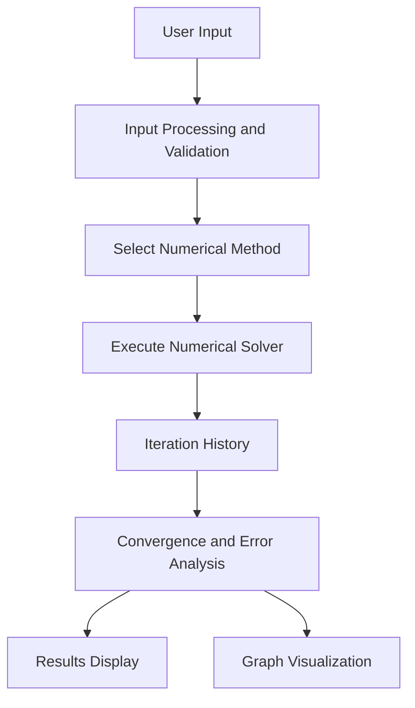

# Numerical Methods Solver

A Python-based desktop application for solving nonlinear equations and systems of linear equations using numerical analysis algorithms. Built with **PySide6**, the application combines scientific computing capabilities with a modern graphical user interface, interactive visualizations, and detailed numerical results.

## 1. Project Overview

The Numerical Methods Solver provides an interactive environment for applying numerical methods to mathematical problems. It helps users perform numerical computations, monitor iterative processes, visualize convergence, and analyze calculated results.

The application currently focuses on three numerical algorithms:

- Bisection Method
- Newton-Raphson Method
- Gauss-Seidel Method

It combines custom numerical algorithm implementations with Python scientific computing libraries to make numerical analysis easier to perform and understand.

## 2. Key Features

### 2.1 Nonlinear Equation Solvers

Implements numerical algorithms for approximating roots of nonlinear equations.

- **Bisection Method:** Finds a root by repeatedly dividing an interval in which a continuous function changes sign.
- **Newton-Raphson Method:** Approximates a root using function values and derivatives, typically providing fast convergence when the initial guess is suitable.
- **Iteration Tracking:** Displays the progress of numerical computations.
- **Convergence Analysis:** Provides visual representations of the iterative process.

### 2.2 Linear System Solver

Implements the Gauss-Seidel iterative method for solving systems of linear equations.

- **Gauss-Seidel Method:** Computes successive approximations to the solution of a linear system (Ax=b).
- **Matrix Processing:** Represents linear equations in matrix form.
- **Convergence Validation:** Checks diagonal dominance as a sufficient convergence condition.
- **Multiple Variables:** Supports systems containing multiple unknown variables.

### 2.3 Graphical User Interface

The application provides an interactive desktop interface built with PySide6.

- Modern dark-themed interface with blue accents.
- Tab-based navigation for different numerical solvers.
- Organized input forms and result displays.
- Scrollable layouts for improved usability.
- Consistent styling across interface components.

### 2.4 Visualization and Numerical Analysis

- Interactive convergence graphs.
- Method-specific visualization styles.
- Graph navigation and inspection controls.
- Visual representation of iterative results.
- Error tracking and convergence analysis.
- Plot export capabilities.

### 2.5 Results and Data Management

- Structured presentation of numerical results.
- Iteration history for examining computation steps.
- Error analysis during numerical calculations.
- Organized output for interpreting and comparing results.

## 3. Technical Architecture

The application follows a modular architecture that separates the graphical interface, numerical algorithms, mathematical utilities, and result visualization.

### Frontend

| Technology     | Responsibility                       |
| -------------- | ------------------------------------ |
| PySide6        | Desktop graphical user interface     |
| Matplotlib     | Interactive graphs and visualization |
| Custom Widgets | Specialized interface components     |

### Backend

| Technology       | Responsibility                               |
| ---------------- | -------------------------------------------- |
| Python           | Core application logic                       |
| NumPy            | Numerical computations and matrix operations |
| Custom Solvers   | Implementation of numerical algorithms       |
| Python Threading | Background computation, where implemented    |

### Application Workflow



The application receives mathematical inputs, validates them, executes the selected numerical algorithm, and presents the resulting calculations through tables and visualizations.

## 4. Supported Numerical Methods

### 4.1 Bisection Method

**Purpose:** Finding approximate roots of continuous nonlinear functions.

**Requirements:**

- The function must be continuous over the selected interval.
- The function values at the interval endpoints must have opposite signs.

**Convergence:** Linear convergence.

**Main Advantage:** Provides reliable convergence when the required conditions are satisfied.

**Limitation:** Usually requires more iterations than faster root-finding methods.

### 4.2 Newton-Raphson Method

**Purpose:** Finding approximate roots using function values and derivatives.

**Requirements:**

- The function should be differentiable near the root.
- The derivative should be nonzero at the iterations.
- A suitable initial guess is important.

**Convergence:** Quadratic convergence near a simple root under appropriate conditions.

**Main Advantage:** Often converges rapidly when the initial approximation is suitable.

**Limitation:** May fail to converge or diverge when the initial guess is unsuitable or the derivative is problematic.

### 4.3 Gauss-Seidel Method

**Purpose:** Solving systems of linear equations represented as:

[
Ax=b
]

**Requirements:**

- The coefficient matrix must satisfy appropriate convergence conditions.
- Strict diagonal dominance is a sufficient condition for convergence.

**Convergence:** Iterative convergence, depending on the properties of the coefficient matrix.

**Main Advantage:** Uses successive approximations to solve systems of linear equations.

**Limitation:** Convergence is not guaranteed for every matrix.

## 5. Installation and Setup

### Prerequisites

- Python 3.8 or later
- pip package manager

### Step 1: Clone the Repository

```bash
git clone https://github.com/Michaella4110/numerical_methods_project.git
cd numerical_methods_project
```

### Step 2: Install Dependencies

```bash
pip install -r requirements.txt
```

### Step 3: Run the Application

```bash
python src/gui.py
```

## 6. Usage Examples

### 6.1 Nonlinear Equation

Find an approximate root of:

[
f(x)=x^3-x-1
]

**Bisection Method:**

- Initial interval: `[1.0, 2.0]`
- Tolerance: `1e-6`

**Newton-Raphson Method:**

- Initial guess: `1.0`
- Tolerance: `1e-6`

### 6.2 System of Linear Equations

Solve the following system using the Gauss-Seidel method:

```text
10x + 2y - z = 27
-3x - 6y + 2z = -61.5
x + y + 5z = -21.5
```

**Initial Guess:**

```python
[0, 0, 0]
```

## 7. Project Structure

```text
numerical_methods_project/
│
├── .vscode/
├── data/
├── docs/
├── plots/
│
├── src/
│   ├── solvers/
│   │   ├── __init__.py
│   │   ├── bisection.py
│   │   ├── gauss_seidel.py
│   │   └── newton.py
│   │
│   ├── __init__.py
│   ├── gui.py
│   ├── main_runner.py
│   ├── matrix_utils.py
│   ├── theme.py
│   └── utils.py
│
├── tests/
│   ├── test_bisection.py
│   ├── test_gauss_seidel.py
│   └── test_newton.py
│
├── README.md
├── requirements.txt
└── LICENSE
```

## 8. Testing

The project includes automated unit tests using Pytest to verify the numerical solver implementations.

Run the test suite:

```bash
pytest tests/
```

The test modules cover:

- Bisection Method
- Newton-Raphson Method
- Gauss-Seidel Method

## 9. User Interface and Performance

### Input Validation

- Equation syntax validation.
- Numerical input validation.
- Convergence condition checks.
- Informative error messages.

### Application Performance

- Iteration progress tracking.
- Background computation where implemented.
- Responsive interface during supported operations.
- Organized handling of numerical results.

### Visualization and Usability

- Interactive graph navigation.
- Clear presentation of numerical results.
- Structured iteration tables.
- Dark-themed interface with consistent visual components.

## 10. Educational Applications

The project can be useful in several academic and technical contexts:

- **Mathematics Students:** Understanding numerical methods through practical computation.
- **Engineering Students:** Applying numerical algorithms to mathematical and engineering problems.
- **Computer Science Students:** Understanding algorithm implementation and numerical computation.
- **Educators:** Demonstrating iterative methods and convergence behavior in numerical analysis courses.

## 11. Future Improvements

Potential extensions to the application include:

- [ ] Implement additional numerical methods, such as the Secant and Fixed-Point Iteration methods.
- [ ] Add matrix visualization tools.
- [ ] Expand result and graph export options.
- [ ] Introduce batch processing for multiple mathematical problems.
- [ ] Support additional numerical analysis algorithms.
- [ ] Expand automated test coverage.
- [ ] Improve application performance and documentation.
- [ ] Explore a web-based version of the application.

## 12. Contributing

Contributions and suggestions are welcome.

Potential areas for improvement include:

- Implementing additional numerical algorithms.
- Improving the graphical user interface.
- Enhancing numerical accuracy and performance.
- Expanding automated tests.
- Improving documentation.
- Reporting bugs and suggesting new features.

## 13. License

This project is licensed under the MIT License. See the `LICENSE` file for details.

## 14. Acknowledgments

- **PySide6:** For providing Python bindings for the Qt framework.
- **NumPy:** For numerical computing capabilities.
- **Matplotlib:** For data visualization and graphing.
- **Pytest:** For automated testing.
- **Numerical Analysis Community:** For the mathematical foundations of the implemented algorithms.

---

**Project Maintainer:** Tesfamichael Assefa

**Technologies:** Python, PySide6, NumPy, Matplotlib, and Pytest.
